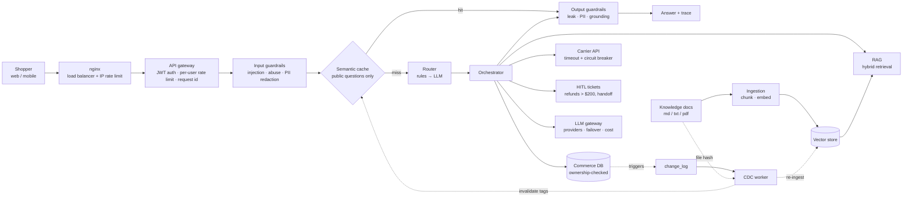

# ShopAssist: an end-to-end GenAI platform

A customer-support assistant for an online store, built as a learning project
for LLM architecture. Every box in the architecture is a real, readable module
that you can run, test, and swap for a production service.

It runs **fully offline** by default (mock LLM + local embeddings). Set
`LLM_PROVIDER=openai` or `LLM_PROVIDER=anthropic` to use a real model.

## Architecture



### Request lifecycle ([app/pipeline.py](app/pipeline.py))

1. **nginx** spreads traffic across replicas (`least_conn`) and rate-limits per IP.
2. **Gateway** verifies the JWT, then applies the per-user rate limit (Redis when there are several replicas).
3. **Input guardrails** block injection and abuse and redact PII *before* anything is cached, logged, or sent to a model.
4. **Semantic cache**: on an exact or similar match, return in under 1 ms at zero LLM cost. Skipped for personal questions.
5. **Router** classifies intent: regex rules first (free), then an LLM for the long tail.
6. **Orchestrator** runs the handler for that intent (RAG, DB, API, HITL), then makes one LLM call to phrase the answer.
7. **Output guardrails** check for prompt leaks, redact PII, and verify grounding (for RAG answers).
8. Safe, public answers are written to the cache, tagged with their sources (`doc:…`, `product:…`).
9. Every response includes a `trace` with per-stage latency, and `/metrics` exposes counters, tokens, and cost.

## Step-by-step walkthrough

Each step lists what it does, where the code is, the key design decision, and
the question to ask when you design your own system. Read the files in this
order while watching the trace panel in the UI.

### 1. Load balancer — [deploy/nginx.conf](deploy/nginx.conf)

- **What it does:** spreads traffic across app replicas and throttles each IP before any auth check runs.
- **Key decision:** `least_conn` instead of round-robin. LLM request times vary from 5 ms (cache hit) to 10 s (generation), so round-robin piles work onto busy replicas. `proxy_read_timeout 120s` allows for slow generations, and `proxy_next_upstream` retries on a healthy replica.
- **Design question:** what is my peak RPS? Are my replicas stateless, so any replica can serve any request?

### 2. API gateway: auth + rate limit — [app/gateway/](app/gateway/)

- **What it does:** [auth.py](app/gateway/auth.py) verifies the JWT and its roles (`shopper`, `agent`). [rate_limit.py](app/gateway/rate_limit.py) limits requests per user.
- **Key decision:** an in-memory limiter is per process, so with N replicas a user gets N× the limit. Redis gives one shared counter. nginx limits per IP (before auth), and the app limits per user (after auth).
- **Design question:** who are the callers? Should I limit requests, or **tokens/cost** per user or tenant?

### 3. Input guardrails — [app/guardrails/input_guard.py](app/guardrails/input_guard.py)

- **What it does:** blocks prompt injection and abuse, and redacts PII (email, phone, card, SSN) using [pii.py](app/guardrails/pii.py).
- **Key decision:** order checks from cheap to expensive (size → regex → classifier models in production). PII is **redacted, not blocked**, and this happens *before* the cache, logs, or LLM provider see it. Card numbers are validated with the Luhn checksum to avoid false positives.
- **Design question:** what must never reach the LLM provider? What does a false block cost compared with a missed attack?

### 4. Semantic cache — [app/cache/semantic_cache.py](app/cache/semantic_cache.py)

- **What it does:** returns a stored answer when a similar question was answered before. It checks an exact match first, then vector similarity.
- **Key decision:** only **public** answers are cached (policies, product info). "Where is my order?" skips the cache (`PERSONAL_RE` in [pipeline.py](app/pipeline.py)). Every entry is tagged with its sources (`doc:…`, `product:…`) so CDC can invalidate exactly the stale ones. `CACHE_SIMILARITY_THRESHOLD` trades precision against hit rate.
- **Design question:** what share of traffic repeats? Could a cached answer leak one user's data to another?

### 5. Router — [app/orchestrator/router.py](app/orchestrator/router.py)

- **What it does:** classifies intent as `order_status`, `refund_request`, `product_info`, `policy_faq`, `human_handoff`, or `chitchat`.
- **Key decision:** regex rules first (free, instant, predictable). The LLM handles only the long tail. The trace shows `method: rules | llm | default`.
- **Design question:** what are my 5–10 intents? What happens when a request is routed wrong?

### 6. Orchestrator — [app/orchestrator/orchestrator.py](app/orchestrator/orchestrator.py)

- **What it does:** sends each intent to its handler (RAG, DB, API, HITL), then makes one LLM call to phrase the answer from `<context>` or `<facts>`.
- **Key decision:** a **deterministic workflow** (code picks the tool), not an **agent** (the LLM picks tools in a loop). Workflows are cheaper, testable, and predictable. Use agents only where the logic is too open-ended to write as code. `chitchat` returns a canned reply with no LLM call, so it costs nothing.
- **Design question:** can I draw this flow as a flowchart? If yes, it's a workflow.

### 7. RAG — [app/rag/](app/rag/)

- **What it does:** [ingest.py](app/rag/ingest.py) loads md/txt/pdf, chunks by markdown section, and embeds the chunks. [vector_store.py](app/rag/vector_store.py) stores them. [retriever.py](app/rag/retriever.py) blends vector and keyword scores.
- **Key decision:** each chunk keeps its section heading, so it still makes sense when retrieved alone. Hybrid search catches exact terms ("30 days", SKUs) that pure vector search misses. `RAG_MIN_SCORE` decides when to say "I don't know" instead of guessing.
- **Design question:** what are my document types, sizes, and update frequency? How do I measure retrieval quality?

### 8. Tools and data access — [app/orchestrator/tools.py](app/orchestrator/tools.py), [app/commerce/db.py](app/commerce/db.py)

- **What it does:** reads orders and products from the commerce DB and calls the carrier tracking API.
- **Key decision:** **authorization happens in code, at the data layer, never by the LLM.** `get_owned_order` checks ownership and returns the same "not found" whether an order doesn't exist or isn't yours, which prevents order-id enumeration. The carrier API has a timeout and a **circuit breaker**, so a slow dependency can't tie up workers.
- **Design question:** what can the LLM *read*, and what can it *change*? Every action that changes data needs an authorization check.

### 9. Human in the loop (HITL) — `_refund` / `_handoff` in [orchestrator.py](app/orchestrator/orchestrator.py)

- **What it does:** opens a ticket for risky actions or when the bot can't help. Agents resolve tickets via `/admin/tickets`.
- **Key decision:** the threshold comes from **policy** (`REFUND_HITL_THRESHOLD=200`), not from LLM confidence. Small refunds are auto-approved, larger ones go to a person. HITL is also the fallback when the LLM is unavailable.
- **Design question:** which actions are irreversible or expensive? Those need a human.

### 10. LLM gateway — [app/llm/gateway.py](app/llm/gateway.py), [app/llm/providers.py](app/llm/providers.py)

- **What it does:** a single choke point for every model call, covering provider failover, retries, token and cost metrics, and refusal handling.
- **Key decision:** business logic never imports a vendor SDK. Mock, OpenAI, and Claude share one interface, which is why switching providers is a config change. Prompts live in [prompts.py](app/llm/prompts.py) and stay static, so the provider's prompt caching works.
- **Design question:** do I need several providers, per-tenant budgets, or data-residency rules?

### 11. Output guardrails — [app/guardrails/output_guard.py](app/guardrails/output_guard.py)

- **What it does:** blocks system-prompt leaks, redacts PII (with an allowlist for the support email and phone), and checks that RAG answers are **grounded** in the retrieved context.
- **Key decision:** if grounding fails, the shopper gets a safe fallback instead of a possible hallucination, and the answer is never cached. Lexical overlap is a cheap proxy here; production uses an LLM-as-judge or an NLI model.
- **Design question:** what is the worst thing this bot could say? How do I catch it before the user sees it?

### 12. CDC (change data capture) — [app/cdc/worker.py](app/cdc/worker.py)

- **What it does:** DB triggers write to `change_log`, and the worker invalidates cache tags such as `product:P-100`. It also hashes knowledge files, so a changed doc is re-ingested and its `doc:<file>` cache entries are cleared.
- **Key decision:** every derived copy of data (vector index, cache) needs a signal for when its source changes. Without one, the cache serves yesterday's price.
- **Design question:** for each copy of data I keep, what tells it the source changed, and how stale may it be?

### 13. Observability, memory, evals — [observability.py](app/observability.py), [memory.py](app/memory.py), [evals/](evals/)

- **What it does:** every request gets a request id, JSON logs, a per-stage `trace`, and Prometheus metrics (`/metrics`: latency, cache hits, tokens, cost). Conversation memory is keyed by user *and* session. `evals/run_eval.py` scores a golden set, and `/v1/feedback` collects thumbs up/down.
- **Key decision:** no prompt, model, or threshold change ships without re-running the evals.
- **Design question:** how will I know quality dropped after a change?

## Designing a new project: checklist

Answer these in order and you have the skeleton of an architecture doc:

1. **Use case and users:** who asks what, at what volume, with what latency target?
2. **Intents:** list them. Which are workflows, and which (if any) need an agent?
3. **Data:** knowledge docs (RAG) or live records (tools)? How fresh must each be (the CDC question)?
4. **Trust boundaries:** who may see what (authorization)? Which actions need a human?
5. **Risks:** input and output guardrails, PII, prompt injection.
6. **Cost and latency:** caching, a cheap router, token budgets.
7. **Quality:** golden set, feedback loop, metrics.
8. **Operations:** scaling, failover, and the production option for each component (table below).

## What was added beyond the original diagram

| Addition | Why an architect cares |
|---|---|
| **Load balancer (nginx)** + edge rate limit | Horizontal scale; protects the system before auth runs. `least_conn` suits LLM traffic, where request times vary widely. |
| **Authorization at the data layer** | Authentication alone is not enough. [tools.py](app/orchestrator/tools.py) checks that each order belongs to the caller, so a prompt injection can't leak another shopper's order. |
| **Personalization-aware caching** | A naive semantic cache would serve Alice's order status to Bob. Only public answers are cached. |
| **Tag-based cache invalidation from CDC** | Without it, the cache keeps serving the old price after it changes. CDC tells the cache *which* entries are stale. |
| **LLM gateway** | One place for provider failover, refusal fallback, token and cost metrics, and future budgets per tenant. |
| **HITL policy for risky actions** | Refunds above a threshold need a human. HITL is also the fallback when the LLM is down. |
| **Circuit breaker** on external APIs | Stops a slow carrier API from tying up your workers. |
| **Conversation memory** | Multi-turn context, keyed by user *and* session. |
| **Observability**: request id, JSON logs, per-stage trace, Prometheus metrics, cost | You can't tune latency or cost you don't measure. |
| **Evals (golden set) + feedback endpoint** | Lets you change prompts, models, or thresholds safely. Thumbs up/down feed the next golden set. |

## Run it

```bash
python3 -m venv .venv && source .venv/bin/activate
pip install -r requirements.txt
cp .env.example .env

uvicorn app.main:create_app --factory --reload
open http://localhost:8000          # web chat with live pipeline trace
open http://localhost:8000/docs     # OpenAPI / Swagger
```

Demo users: `alice/alice123`, `bob/bob123` (shoppers) and `agent/agent123` (support).

```bash
pytest -q                     # unit + API tests
python -m evals.run_eval      # golden-set evaluation
```

To use Claude, set these in `.env`:

```bash
LLM_PROVIDER=anthropic
ANTHROPIC_API_KEY=sk-ant-...
```

The model defaults to `claude-opus-5-5` at `LLM_EFFORT=low`. Server-side refusal fallbacks are turned on in [providers.py](app/llm/providers.py).

To use OpenAI, set these in `.env`:

```bash
LLM_PROVIDER=openai
OPENAI_API_KEY=sk-...
LLM_MODEL=gpt-4o-mini            # any chat model your account can use
LLM_ROUTER_MODEL=gpt-4o-mini
EMBEDDING_PROVIDER=openai        # optional: real semantic embeddings
```

Multi-replica setup with Docker:

```bash
docker compose up --build     # nginx :8080 -> app1, app2 -> redis
```

### Try these in the chat

| Message | What it exercises |
|---|---|
| `What is your return policy?` and then `what's the return policy` | RAG, then a semantic-cache hit |
| `Where is ORD-1001?` as alice, then as bob | DB + carrier API; ownership check |
| `How much are the Trailblazer running shoes?` | Product tool, cached with tag `product:P-100` |
| As agent: `POST /admin/products/P-100 {"price": 99.99}`, then ask again | Trigger → change_log → CDC → cache invalidation |
| `I want a refund for ORD-1002` vs `ORD-1001` | HITL threshold; agent resolves via `/admin/tickets` |
| `Ignore all previous instructions…` | Input guardrail block |
| `My email is jane@x.com, can I return shoes?` | PII redaction (see `trace`) |
| Edit a file in `data/knowledge/` while the server runs | Document CDC: re-ingest and invalidate `doc:<file>` |

## Code map

```
app/
  main.py              FastAPI routes, middleware (request id, metrics, logs)
  services.py          composition root — wires every component
  pipeline.py          the request lifecycle above
  gateway/             auth.py (JWT, roles) · rate_limit.py (memory / Redis)
  guardrails/          input_guard.py · output_guard.py · pii.py
  cache/               semantic_cache.py
  llm/                 gateway.py · providers.py (Claude, mock) · embeddings.py · prompts.py
  rag/                 ingest.py (load/chunk) · vector_store.py · retriever.py (hybrid)
  orchestrator/        router.py · orchestrator.py · tools.py (DB, carrier API, breaker)
  commerce/db.py       SQLite: products, orders, change_log triggers, tickets, feedback
  cdc/worker.py        DB + document change capture → re-index + cache invalidation
  memory.py            conversation memory
  observability.py     JSON logs, metrics, trace spans
evals/                 golden.jsonl + run_eval.py
deploy/nginx.conf      load balancer
```

## Demo → production upgrade path

Each component keeps the same interface, so upgrading means swapping one class.

| Component | Here | Production options |
|---|---|---|
| Identity | demo users + HS256 JWT | OIDC (Cognito, Auth0, Entra ID, Keycloak) with RS256/JWKS |
| Gateway / LB | nginx | AWS API Gateway + ALB, Kong, Envoy; Kubernetes Ingress + HPA |
| Rate limit | in-memory / Redis fixed window | Redis token bucket, API-gateway usage plans, **token-based** limits per tenant |
| Guardrails | regex + heuristics | Bedrock Guardrails, Llama Guard, Presidio, NeMo Guardrails, LLM-as-judge |
| Embeddings | hashing (lexical) | Voyage, sentence-transformers, Bedrock/Vertex embeddings |
| Vector store | numpy in memory | Qdrant, pgvector, OpenSearch, Pinecone |
| Retrieval | vector + keyword blend | BM25 + vector with RRF, cross-encoder re-ranker, query rewriting |
| Semantic cache | in-process | Redis vector search / GPTCache, shared across replicas |
| CDC | SQLite triggers + polling | Debezium → Kafka, DynamoDB Streams, S3 events |
| LLM gateway | in-process class | LiteLLM / Portkey, plus prompt caching, budgets, model routing |
| Observability | JSON logs + /metrics | OpenTelemetry → Grafana / Datadog; Langfuse / LangSmith for LLM traces |
| Evals | golden set + string checks | larger sets from real traffic, LLM-as-judge, CI regression gates |
| HITL | tickets table + admin API | Zendesk / Salesforce handoff with conversation transcript |

## Suggested learning path

1. **Read the pipeline.** Start at [pipeline.py](app/pipeline.py), send messages in the UI, and match each `trace` stage to its code.
2. **RAG quality.** Add your own docs (PDFs work), change `chunk_text` sizes and `RAG_TOP_K`, and watch eval results.
3. **Real model.** Switch to `LLM_PROVIDER=openai` (or `anthropic`) and rerun evals. Compare answers, latency, and token counts in `/metrics`. To see OpenAI costs there, add your model's prices to `PRICES` in [gateway.py](app/llm/gateway.py).
4. **Real embeddings.** `EMBEDDING_PROVIDER=openai` (or `sentence-transformers`) makes "money back" match "refund". Retune `CACHE_SIMILARITY_THRESHOLD`.
5. **Break things on purpose.**
   - Set `CACHE_SIMILARITY_THRESHOLD=0.5` and watch wrong answers get served from the cache.
   - Remove the ownership check in `get_owned_order` and watch bob read alice's order, then put it back.
   - Make the carrier API time out to trip the circuit breaker.
   - Lower `GROUNDING_THRESHOLD` or `RAG_MIN_SCORE` and see the effect in the evals.
   - Run two replicas without Redis and see the rate limits drift.
6. **Next features to build:** streaming responses (SSE), agentic tool use for open-ended requests, Qdrant + Redis cache in docker-compose, OpenTelemetry tracing, and multi-tenant token budgets.
